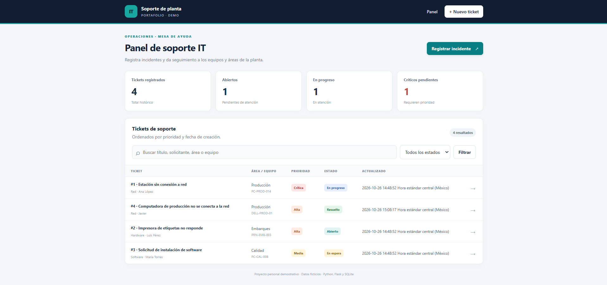
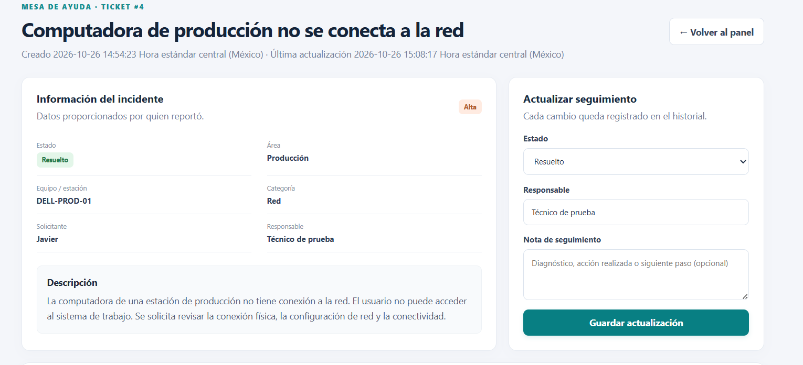
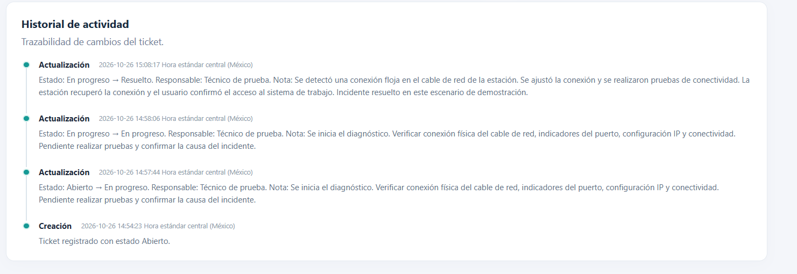

# Soporte IT Planta — Sistema de tickets

Aplicación web local que simula una mesa de ayuda de TI en un entorno de manufactura ficticio. Es un proyecto personal para practicar desarrollo web con Python, bases de datos y seguimiento de incidencias.

## Funcionalidades

- Panel con indicadores de tickets registrados, abiertos, en progreso y críticos pendientes.
- Alta de incidentes con descripción, solicitante, área, estación/equipo, categoría y prioridad.
- Búsqueda por título, solicitante, área o estación y filtro por estado.
- Actualización de estado y responsable.
- Historial de creación y seguimiento de cada ticket.
- Persistencia de datos en SQLite.
- Consultas SQL parametrizadas y validación de campos.
- Interfaz HTML/CSS adaptable a distintos tamaños de pantalla.
- Datos de demostración ficticios opcionales.

## Tecnologías

- Python 3.10 o posterior
- Flask
- SQLite y SQL
- HTML y CSS

## Instalación en Windows (CMD)

Abre una terminal en la carpeta del proyecto y ejecuta estos comandos uno por uno:

```cmd
py -m venv .venv
.venv\Scripts\activate.bat
python -m pip install -r requirements.txt
```

## Cargar datos ficticios y ejecutar

Para cargar tres tickets de ejemplo, ejecuta `seed_demo.py` **una sola vez**:

```cmd
python seed_demo.py
```

Luego inicia el servidor:

```cmd
python app.py
```

Abre la aplicación en el navegador en [http://127.0.0.1:5000](http://127.0.0.1:5000). Mantén la terminal abierta mientras utilizas el sitio. Detén el servidor con `Ctrl + C`.

En PowerShell, activa el entorno con `\.venv\Scripts\Activate.ps1` en lugar del comando de activación para CMD. En macOS/Linux, usa `source .venv/bin/activate`.

## Estructura

```text
soporte-it-planta/
├── app.py
├── seed_demo.py
├── requirements.txt
├── README.md
├── .gitignore
├── templates/
│   ├── base.html
│   ├── index.html
│   ├── new_ticket.html
│   ├── ticket_detail.html
│   └── 404.html
├── static/
│   └── styles.css
└── docs/
    └── CAPTURAS.md
```

## Modelo de datos

- `tickets`: título, descripción, solicitante, área, estación, categoría, prioridad, estado, responsable y fechas de creación/actualización.
- `ticket_history`: acciones y notas de seguimiento relacionadas con cada ticket mediante una clave foránea.

Un ticket puede tener varios eventos asociados en el historial, lo que permite revisar cómo se actualizó su estado y asignación.

## Checklist de pruebas manuales

- [ ] Abrir el panel y revisar los tickets de ejemplo.
- [ ] Crear un ticket nuevo y confirmar que aparece con identificador.
- [ ] Abrir el detalle del ticket.
- [ ] Cambiar estado y responsable, añadir una nota y guardar.
- [ ] Confirmar que el historial muestra la actualización.
- [ ] Detener y reiniciar la aplicación; verificar que el ticket y su historial permanecen.
- [ ] Probar una búsqueda y un filtro de estado.

## Limitaciones y seguridad

Esta es una demostración local; no es un sistema listo para producción. No incluye inicio de sesión, autorización por roles, notificaciones ni adjuntos. La clave de sesión predeterminada está pensada solo para desarrollo local. No introduzcas información real de empleados, credenciales ni datos confidenciales. No expongas la aplicación a Internet sin implementar autenticación, autorización, configuración segura y pruebas adicionales.

## Capturas de pantalla

### Panel principal


### Detalle del incidente


### Historial de seguimiento


## Capturas de pantalla

### Panel principal


### Detalle del incidente


### Historial de seguimiento

